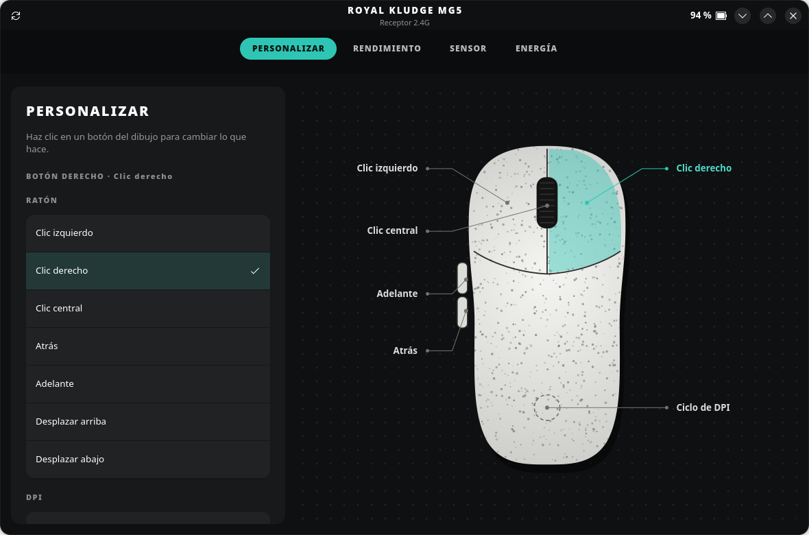
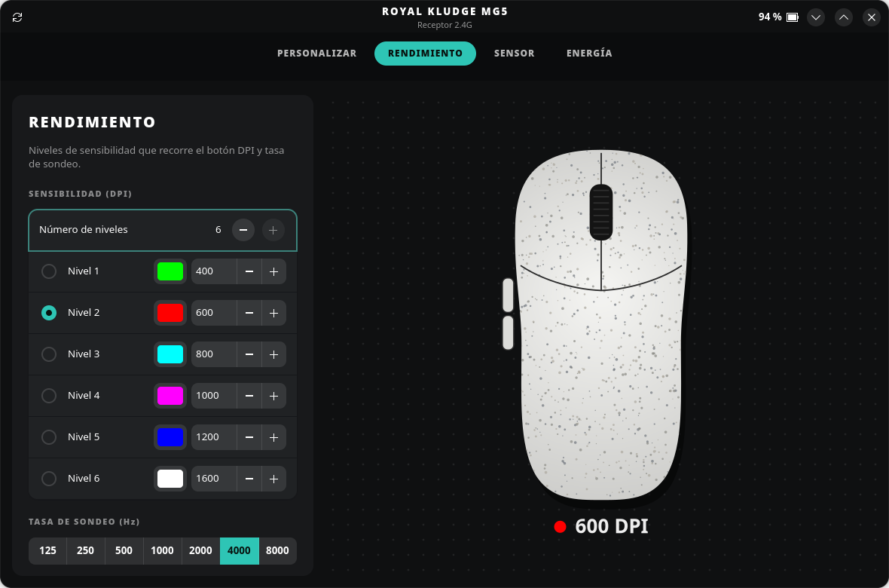

# Open RK MG5 Control Panel

Panel de control para Linux del ratón **Royal Kludge MG5**: DPI por niveles, colores, frecuencia de sondeo,
LOD, debounce, modo del sensor, Motion Sync, Ripple Control, corrección de ángulo, modo cristal, reposo
y reasignación de los seis botones (ratón, DPI, multimedia o cualquier tecla con modificadores).

Funciona con el receptor 2.4G (`372e:103f`) y, en principio, por cable (`372e:1073`, aún sin probar).
El protocolo está documentado en [docs/PROTOCOL.md](docs/PROTOCOL.md).

### RK M30 (experimental, sin probar)

También reconoce el **Royal Kludge M30** (`258a:0138` receptor 2.4G, `258a:0136` cable), con un protocolo
distinto sacado del configurador web oficial. **Nadie lo ha probado todavía con un M30 real.** La app muestra
un aviso cuando hay uno conectado y solo ofrece lo que tiene: DPI 100–24000 en pasos de 100, hasta 6 niveles,
sondeo hasta 1000 Hz, LOD, debounce (1–15 ms), Motion Sync, Ripple Control, corrección de ángulo y reposo.
No hay batería, modo del sensor ni modo cristal, y la reasignación de botones está desactivada porque el M30
no permite leerla.

Antes de cambiar nada, si tienes un M30, prueba la lectura (no escribe nada en el ratón) y comparte la salida en un issue:

```bash
python3 -m rk_mg5 --probe
```




## Instalación

Cada versión publicada en [Releases](https://github.com/blzkz/open-rk-mg5-control-panel/releases) trae paquetes listos:

| Distribución | Archivo | Instalar |
|---|---|---|
| Arch, CachyOS, Manjaro | `.pkg.tar.zst` | `sudo pacman -U open-rk-mg5-control-panel-*.pkg.tar.zst` |
| Fedora | `.rpm` | `sudo dnf install ./open-rk-mg5-control-panel-*.rpm` |
| Ubuntu 24.04+, Debian 13+ | `.deb` | `sudo apt install ./open-rk-mg5-control-panel_*_all.deb` |
| Cualquier otra (Flatpak) | `.flatpak` | `flatpak install --user open-rk-mg5-control-panel-*.flatpak` |

Los paquetes nativos instalan también la regla udev que da acceso al ratón. Con Flatpak hay que añadirla a mano
(ver [Permisos](#permisos)); la app te lo recuerda si falta.

### Desde el código

Requiere Python 3.10+, GTK 4 y libadwaita 1.5+ con PyGObject (en Arch/CachyOS: `python-gobject gtk4 libadwaita`).
No hay más dependencias: la comunicación con el ratón va directamente por `/dev/hidraw`.

## Permisos

Para acceder al ratón sin root hace falta la regla udev de `udev/70-rk-mg5.rules`:

```bash
sudo cp udev/70-rk-mg5.rules /etc/udev/rules.d/
sudo udevadm control --reload-rules && sudo udevadm trigger
```

## Uso

```bash
python3 -m rk_mg5
```

Los cambios se guardan en el ratón en cuanto se modifican en la ventana.
Si el ratón está dormido, muévelo y la app se reconectará sola.

Con `--hidden` arranca directamente en la bandeja.

### Perfiles

Un perfil guarda todo lo que el ratón almacena: botones, niveles y colores de DPI, sondeo, LOD, debounce,
modo del sensor, interruptores y reposo. El selector de la barra superior cambia de perfil y el menú `⋮`
crea, duplica, renombra o elimina perfiles. Los cambios que hagas se guardan en el perfil activo.

Se guardan como JSON en `~/.config/open-rk-mg5/profiles/`.

### Bandeja del sistema

El icono de la bandeja muestra la batería en el tooltip, cambia a un aviso con batería baja (y lanza una
notificación) y su menú permite cambiar de perfil al vuelo. Usa el protocolo StatusNotifierItem, así que
funciona en KDE Plasma y en GNOME con la extensión AppIndicator.

En Preferencias se elige si cerrar la ventana la minimiza a la bandeja, si arranca con la sesión y el umbral
de batería baja.

## Tests

```bash
python3 -m unittest discover -s tests
```

## Publicar una versión

1. Actualiza `__version__` en `rk_mg5/__init__.py` y añade la versión a `data/io.github.blzkz.OpenRkMg5.metainfo.xml`.
2. Crea una release en GitHub con una etiqueta `vX.Y.Z`.
3. El workflow *Build packages* compila los cuatro paquetes y los adjunta a la release.

## Licencia

GPL-3.0-or-later. Royal Kludge, MG5 y M30 son marcas de sus propietarios; este proyecto no está afiliado a Royal Kludge.
